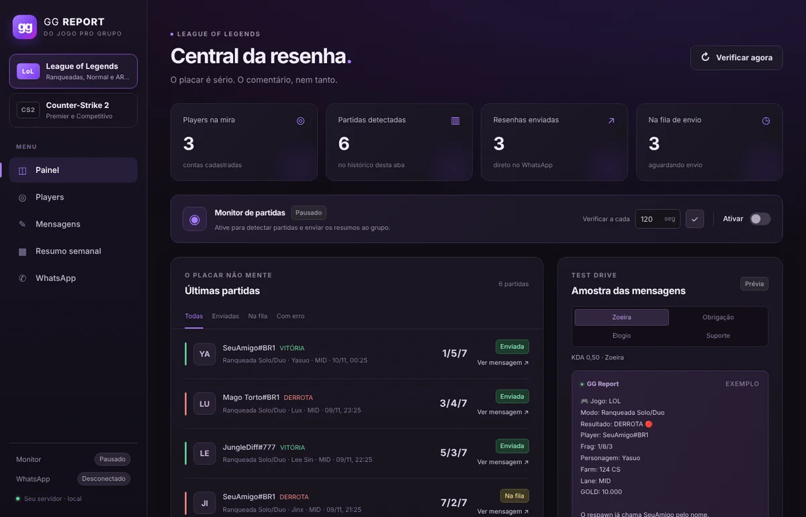
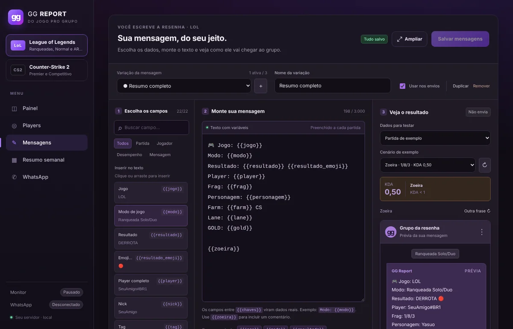
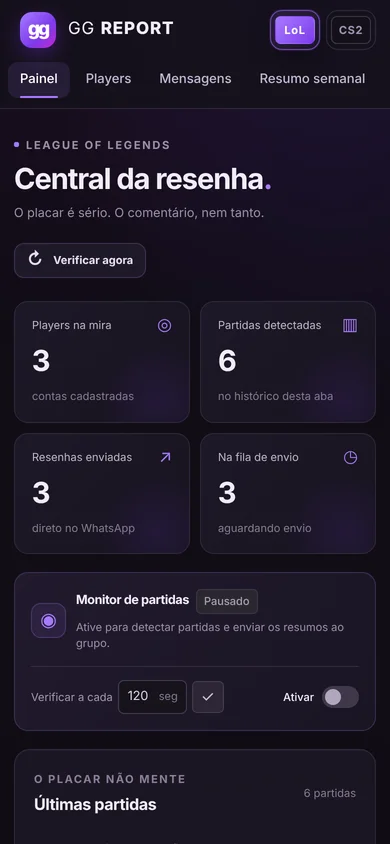
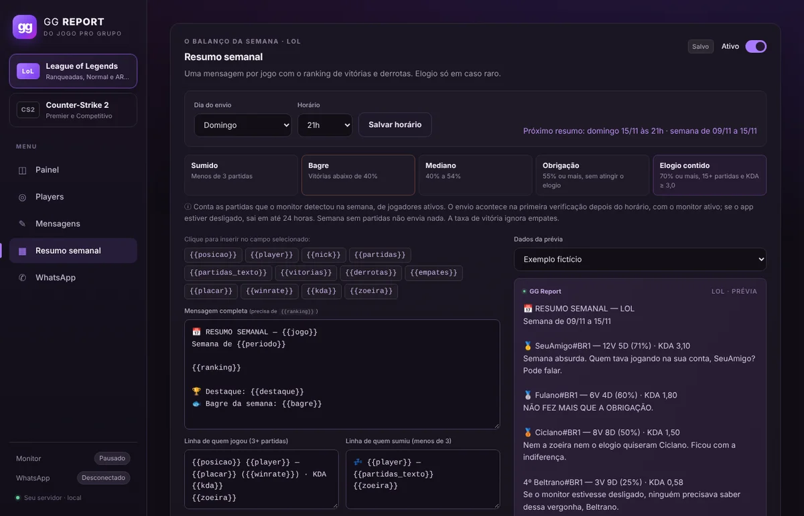

<div align="center">

# GG Report

**Do jogo pro grupo.** Partidas de **League of Legends**, **Counter-Strike 2** e **Rainbow Six Siege** viram um resumo com estatísticas e zoeira no grupo do WhatsApp, e todo domingo sai o ranking da semana.


-25d366?logo=whatsapp&logoColor=white)



</div>

## Sumário

- [Recursos](#recursos)
- [Começo rápido](#começo-rápido)
- [Usando a interface](#usando-a-interface)
- [Exemplos de mensagem](#exemplos-de-mensagem)
- [Personalizar as mensagens](#personalizar-as-mensagens)
- [Resumo semanal](#resumo-semanal)
- [Counter-Strike 2: detecção pela Steam](#counter-strike-2-detecção-pela-steam)
- [Rainbow Six Siege: dados da stats.cc](#rainbow-six-siege-dados-da-statscc)
- [Como funciona](#como-funciona)
- [Configuração e segurança](#configuração-e-segurança)
- [Operação e atualização](#operação-e-atualização)
- [Desenvolvimento](#desenvolvimento)
- [Estrutura do projeto](#estrutura-do-projeto)

## Recursos

- 🎮 **Três jogos:** League of Legends (Ranqueada Solo/Duo, Flex, Normal e ARAM), Counter-Strike 2 (Premier e Competitivo) e Rainbow Six Siege (Ranqueada, Padrão e Legend Division).
- 📲 **Envio automático ao WhatsApp:** conecte por QR Code, escolha o grupo e cada partida nova chega com o placar.
- 😈 **Zoeira pelo KDA:** o comentário muda conforme o desempenho, e elogio só aparece em caso raro.
- ✍️ **Editor visual de mensagens:** variáveis clicáveis, várias variações por jogo, frases editáveis e prévia em tempo real.
- 📅 **Resumo semanal:** ranking de vitórias e derrotas, destaque e “bagre” da semana, no dia e no horário que você escolher.
- 🛡️ **Fila confiável:** sem mensagens duplicadas após reinícios, com novas tentativas automáticas e reenvio manual.
- 🪶 **Leve:** Node.js 24, SQLite nativo e interface sem build, num único container. Sem Java, Chromium, Redis, banco separado ou serviço de IA.

<table>
  <tr>
    <td width="68%"></td>
    <td width="32%"></td>
  </tr>
  <tr>
    <td align="center"><sub>Editor de mensagens com prévia</sub></td>
    <td align="center"><sub>Versão para celular</sub></td>
  </tr>
</table>

## Começo rápido

Pré-requisito: Docker com Compose (por exemplo, Docker Desktop).

**1. Crie o arquivo de configuração**

```powershell
Copy-Item .env.example .env     # no Linux: cp .env.example .env
```

**2. Preencha as chaves dos jogos que você vai monitorar**

| Variável | Jogo | Onde obter |
| --- | --- | --- |
| `RIOT_API_KEY` | League of Legends | [Portal da Riot](https://developer.riotgames.com/). As [chaves de desenvolvimento expiram a cada 24 horas](https://support-developer.riotgames.com/hc/en-us/articles/22698431229203-Developer-Portal-Overview); para uso contínuo, solicite a modalidade adequada no portal. |
| `STEAM_API_KEY` | Counter-Strike 2 | [Steam Web API](https://steamcommunity.com/dev/apikey). Resolve perfis por `SteamID64` e consulta novos códigos de partida (`GetNextMatchSharingCode`). |
| `LEETIFY_API_KEY` | Counter-Strike 2 (opcional) | [Leetify Developers](https://leetify.com/app/developer). Amplia o limite de consultas das estatísticas extraídas das demos `.dem`. |
| `STATS_CC_API_KEY` | Rainbow Six Siege | Chave concedida pela [stats.cc](https://api.stats.cc/siege/docs) com os escopos `profiles` e `matches`. Uso gratuito, só no servidor. |

**3. Suba o container**

```powershell
docker compose up -d --build
```

Abra **http://localhost:3000**. Sem chaves, a interface e as prévias já funcionam; o cadastro real de players e o monitor dependem da chave do respectivo jogo.

> [!IMPORTANT]
> Depois de alterar o `.env`, use `docker compose up -d --force-recreate`. O `docker compose restart` **não** recarrega as variáveis. O volume `gg-data` (players, histórico, mensagens personalizadas e sessão do WhatsApp) é preservado.

## Usando a interface

O menu lateral (no celular, no topo) traz o seletor de jogo e as seções **Painel**, **Players**, **Mensagens**, **Resumo semanal** e **WhatsApp**. O status do monitor e do WhatsApp fica sempre visível no menu.

1. **Escolha o jogo** no menu (League of Legends, Counter-Strike 2 ou Rainbow Six Siege) e abra **Players**:
   - **LoL:** cadastre o nick e a tag separadamente (`SeuAmigo` e `BR1`). Para o servidor brasileiro, use **Américas**.
   - **CS2:** informe o **SteamID64** de 17 dígitos (ou a URL `https://steamcommunity.com/profiles/...`) e, se quiser, a [autorização de partidas da Steam](#formas-de-cadastrar-um-jogador).
   - **R6:** escolha a plataforma (PC, PlayStation ou Xbox) e informe o nick do Siege. O GG Report guarda o identificador do perfil, então trocar de nick não quebra o acompanhamento.
2. **Conecte o WhatsApp** na seção **WhatsApp**: no celular, abra **Aparelhos conectados → Conectar aparelho** e leia o QR Code.
3. **Escolha o grupo**: atualize a lista, selecione o destino e salve. A conexão e o grupo valem para todos os jogos.
4. **Ajuste o intervalo** de consulta no **Painel** (padrão: 120 segundos; mínimo: 30).
5. **Ative o monitor.** A partir daí, as partidas novas de LoL, CS2 e R6 são consultadas e enviadas automaticamente.

O monitor começa pausado e nenhuma conta ou chave vem cadastrada. As prévias são locais: **não gravam partidas nem enviam mensagens**.

## Exemplos de mensagem

<table>
<tr><th>League of Legends</th><th>Counter-Strike 2</th></tr>
<tr><td>

```text
🎮 Jogo: LOL
Resultado: DERROTA 🔴
Modo: Ranqueada Solo/Duo
Player: SeuAmigo#BR1
Frag: 1/5/9
KDA: 2,00
Personagem: Yasuo
Farm: 124 CS
Lane: MID
GOLD: 10.000

NÃO FEZ MAIS QUE A OBRIGAÇÃO
```

</td><td>

```text
🎮 Jogo: CS2
Modo: Premier
Resultado: VITÓRIA 🟢
Mapa: Mirage
Placar: 13 x 11
Player: SeuAmigo
Frag: 15/14/4
KDA: 1,36
ADR: 78,2

NÃO FEZ MAIS QUE A OBRIGAÇÃO
```

</td></tr>
</table>

O KDA decide se o comentário será zoeira, obrigação ou elogio moderado. Textos e frases de cada jogo são editáveis pela interface, sem custo de IA. A classificação é uma brincadeira baseada no placar, não uma avaliação completa do desempenho.

## Personalizar as mensagens

Cada jogo tem seu próprio editor em **Mensagens**, com rascunho, variações, frases e prévia independentes.

1. **Escolha os campos:** busque ou filtre as variáveis e clique (ou arraste) para inseri-las na posição do cursor.
2. **Monte a mensagem:** use campos entre chaves duplas, como `{{player}}`, `{{frag}}` e `{{modo}}`. `{{zoeira}}` insere o comentário.
3. **Veja o resultado:** a prévia usa o rascunho sem salvar, com uma partida de exemplo ou uma partida real do histórico.

Clique em **Salvar mensagens** para aplicar às próximas partidas do jogo selecionado. **Carregar modelos originais** apenas preenche o rascunho; salve se quiser aplicá-los. Mensagens que já estavam na fila mantêm o texto original. O botão **Ampliar** abre o editor em tela cheia (Esc fecha).

<details>
<summary><b>Variáveis disponíveis</b></summary>

- **League of Legends (22):** `jogo`, `modo`, `resultado`, `resultado_emoji`, `player`, `nick`, `tag`, `frag`, `kills`, `deaths`, `assists`, `kda`, `personagem`, `farm`, `lane`, `gold`, `gold_bruto`, `duracao`, `duracao_segundos`, `data`, `partida_id`, `zoeira`. Vem com três variações iniciais e 51 frases entre **Zoeira**, **Obrigação**, **Elogio** e **Elogio ao suporte**.
- **Counter-Strike 2 (21):** `jogo`, `modo`, `resultado`, `resultado_emoji`, `player`, `nick`, `frag`, `kills`, `deaths`, `assists`, `kda`, `mapa`, `placar`, `adr`, `dano`, `rounds`, `mvps`, `hs`, `data`, `partida_id`, `zoeira`. Vem com três variações iniciais e 39 frases entre **Zoeira**, **Obrigação** e **Elogio**.
- **Rainbow Six Siege (23):** `jogo`, `modo`, `resultado`, `resultado_emoji`, `player`, `nick`, `plataforma`, `mapa`, `placar`, `frag`, `kills`, `deaths`, `assists`, `kda`, `rounds`, `hs`, `aberturas`, `clutches`, `rank`, `pontos`, `data`, `partida_id`, `zoeira`. Vem com três variações iniciais e 39 frases entre **Zoeira**, **Obrigação** e **Elogio**. Toda mensagem do R6 termina com o crédito fixo **📊 Data by Stats.cc**, exigido pela stats.cc; ele fica fora do editor e não pode ser removido.

No LoL, `{{modo}}` usa primeiro a fila da partida ([lista de filas da Riot](https://static.developer.riotgames.com/docs/lol/queues.json)) e depois o modo bruto, diferenciando **Ranqueada Solo/Duo**, **Ranqueada Flex**, **Normal** e **ARAM**. No CS2, `{{modo}}` distingue **Premier** e **Competitivo**, e `{{mapa}}` formata nomes internos como `de_mirage` para `Mirage`. Em empates (`12 x 12` no Competitivo ou `15 x 15` no Premier), `{{resultado}}` exibe `EMPATE` com `🟡`. No R6, `{{modo}}` mostra **Ranqueada**, **Padrão** ou **Legend Division**; `{{resultado}}` também pode ser `ABANDONO`, `RENDIÇÃO` ou `DERROTA POR W.O.`; `{{aberturas}}` é abates/mortes de abertura; `{{rank}}` e `{{pontos}}` (como `+23`) só existem em partidas ranqueadas e viram `N/A` nas demais.

</details>

### Qual frase entra em `{{zoeira}}`

`{{kda}}` é **(abates + assistências) ÷ máximo(1, mortes)** em todos os jogos. O texto mostra duas casas decimais, mas a escolha da frase usa o valor completo.

| Partida | Comentário |
| --- | --- |
| KDA menor que 1 | Zoeira ácida, mesmo com vitória |
| KDA 1 ou mais, sem atingir o elogio | Obrigação: “NÃO FEZ MAIS QUE A OBRIGAÇÃO” |
| **LoL e R6:** KDA 4 ou mais **e** vitória · **CS2:** KDA 3 ou mais **e** vitória | Elogio raro, sempre com alfinetada |

- Derrota, empate ou abandono nunca recebe elogio, por maior que seja o KDA.
- No LoL, quem joga na lane `SUP` e atinge o elogio recebe uma frase de **Elogio ao suporte**. Exemplo: `1/5/9` dá **2,00** (obrigação); `1/5/19` com vitória dá **4,00** (elogio ao suporte).
- As frases ficam **uma por linha**, até 30 por categoria, e aceitam variáveis (exceto `{{zoeira}}`).
- Frases padrão antigas que nunca foram editadas são atualizadas automaticamente uma vez; categorias que você editou ficam como estão.

## Resumo semanal



Todo **domingo às 21h** (horário de Brasília; dia e hora ajustáveis), o GG Report envia **uma mensagem por jogo** com o ranking da semana:

```text
📅 RESUMO SEMANAL — LOL
Semana de 03/11 a 09/11

🥇 SeuAmigo#BR1 — 12V 5D (71%) · KDA 3,10
Semana de smurf. Suspeito, mas os números não mentem: 12V 5D.

🥈 Fulano#BR1 — 3V 9D (25%) · KDA 0,58
Semana tão ruim que até o matchmaking pediu desculpa pros seus aliados.

💤 Sicrano#BR1 — 1 partida
Semana de folga. Não perdeu ponto porque nem teve coragem de jogar.

🏆 Destaque: SeuAmigo#BR1
🐟 Bagre da semana: Fulano#BR1
```

A frase de cada jogador depende da faixa. **O elogio é raro de propósito:** exige as três condições ao mesmo tempo.

| Faixa | Condição | Tom |
| --- | --- | --- |
| Sumido | menos de 3 partidas | zoeira por não jogar |
| Bagre | taxa de vitória abaixo de 40% | zoeira ácida |
| Mediano | 40% a 54% | zoeira leve |
| Obrigação | 55% ou mais, sem atingir o elogio | “NÃO FEZ MAIS QUE A OBRIGAÇÃO”, troféu de participação |
| Elogio contido | 70% ou mais **e** 15+ partidas **e** KDA da semana ≥ 3,0 | quase elogio, sempre com alfinetada |

<details>
<summary><b>Regras de cálculo e de envio</b></summary>

- **Taxa de vitória:** vitórias ÷ (vitórias + derrotas); empates do CS2 não entram. **KDA da semana:** (abates + assistências) ÷ mortes, somando todas as partidas.
- **Quem entra:** jogadores ativos do jogo. Pausados ficam de fora; quem não jogou aparece como sumido. Semana sem nenhuma partida não gera mensagem.
- **Quais partidas contam:** as que o monitor **detectou** na semana (do horário de envio anterior até o atual). Assim nenhuma partida conta duas vezes nem se perde; uma partida de CS2 terminada perto das 21h cuja demo demore pode entrar na semana seguinte.
- **Envio:** na primeira verificação após o horário, com o monitor ativo e o WhatsApp conectado. Se o app estiver desligado, o resumo sai em até 24 horas; depois disso, a semana é pulada. Cada semana é registrada uma única vez por jogo (reiniciar o Docker não repete), com até cinco tentativas e botão para reenviar.
- **Personalização:** modelo da mensagem (precisa de `{{ranking}}`), linha de quem jogou, linha de quem sumiu e frases de cada faixa. A prévia usa a semana em andamento, a última semana encerrada ou um exemplo fictício, **sem enviar nada**.

</details>

## Counter-Strike 2: detecção pela Steam

O GG Report acompanha apenas partidas oficiais **Premier** e **Competitivo** da Valve. Não depende de o jogo estar aberto, de Game State Integration (GSI), de FACEIT nem da senha da conta Steam.

### Formas de cadastrar um jogador

1. **Com autorização oficial da Steam (recomendado):** informe o `SteamID64`, o **Código de autenticação da partida** (`AAAA-AAAAA-AAAA`) e o **Código de uma partida recente** (`CSGO-xxxxx-xxxxx-xxxxx-xxxxx-xxxxx`). O próprio jogador gera os dois na [página de dados pessoais do CS2 na Steam](https://help.steampowered.com/pt-br/wizard/HelpWithGameIssue/?appid=730&issueid=128) (*Authentication Codes* / *Match Sharing Codes*). São códigos somente de leitura do histórico e **nunca pedem login ou senha**. Dá para adicioná-los ou atualizá-los depois pelo botão **Código Steam** na lista de players.
2. **Somente pelo `SteamID64`:** com os campos de código em branco, o cadastro consulta o histórico público do jogador no [Leetify](https://leetify.com/), o que exige partidas públicas indexadas lá.

<details>
<summary><b>Limitações da API da Valve e por que o Leetify é usado</b></summary>

- O endpoint oficial `ICSGOPlayers_730/GetNextMatchSharingCode/v1` informa apenas o próximo código `CSGO-...` jogado pela conta (que codifica `matchId`, `reservationId` e `tvPort`), **sem mapa, placar, resultado, K/D/A, ADR nem a URL da demo `.dem`**.
- Baixar o `.dem.bz2` direto da Valve exige autenticar uma conta Steam real (usuário, senha e Steam Guard) no *Game Coordinator* do CS2 (`appid 730`) e baixar dezenas de megabytes por partida, o que é incompatível com a segurança (sem senha Steam) e com a proposta leve de um único container.
- Por isso, o GG Report usa `GetNextMatchSharingCode` para descobrir cada partida nova e consulta a API pública do **Leetify** (`api-public.cs-prod.leetify.com`, Data Provided by Leetify) para ler as estatísticas já extraídas da demo: **mapa, placar, vitória/derrota/empate, kills, deaths, assists, KDA, ADR, dano total, rounds, MVPs e % de headshots**.
- Partidas de FACEIT, Braço Direito (*Wingman*) ou outras fontes são ignoradas automaticamente.
- A análise da demo pode levar alguns minutos depois do fim da partida. Códigos recém-detectados aguardam sem avançar o cursor nem duplicar mensagens; após 45 minutos sem demo disponível, o cursor avança para não bloquear as partidas seguintes.
- Nenhuma estatística é inventada ou estimada: um campo opcional que não vier da fonte aparece como `N/A`.

</details>

## Rainbow Six Siege: dados da stats.cc

O R6 usa a [API da stats.cc](https://api.stats.cc/siege/docs) (`https://api.stats.cc/siege`), com a chave enviada no cabeçalho `x-api-key` apenas pelo servidor.

- **Cadastro:** `GET /v2/profiles/{plataforma}/{nick}` devolve o `profile_id` (UUID), que é o que fica salvo. Um perfil que a stats.cc nunca buscou pode responder `unknown_profile`; o app tenta de novo uma vez após alguns segundos. Perfis ocultos pelo dono (`hidden_profile`) não são cadastrados e, se forem ocultados depois, o player é pausado automaticamente.
- **Partidas:** `GET /v2/profiles/{id}/matches?after=<última partida>` traz só as partidas novas. A partida mais recente no cadastro vira referência: **nada de histórico antigo é buscado** (a stats.cc pede para não fazer backfill). A stats.cc atualiza as partidas até 5 minutos depois do fim.
- **Filas que contam:** `ranked` (Ranqueada), `unranked` (Padrão) e `legend-division` (Legend Division). Partida Rápida, eventos, arcade, personalizadas e partidas canceladas são ignoradas.
- **Nomes:** mapas, ranks e plataformas vêm em slug e são resolvidos pelo `GET /v2/config` (sem chave, com cache de 12 horas).
- **Limites:** o app respeita os cabeçalhos `RateLimit-*` e o `Retry-After`. Um `429` ou `503` da stats.cc pausa só as consultas do R6; LoL, CS2 e a fila do WhatsApp continuam. Sem os escopos `profiles` e `matches`, a API responde `403 missing_scope` e o erro aparece no player.
- **Atualização forçada:** o `POST /v2/profiles/{id}/update` não é usado; o intervalo de consulta normal já pega as partidas logo depois que a stats.cc as processa.

## Como funciona

```text
 Riot API ─┐                                       ┌─► Grupo do WhatsApp
           ├─► Monitor ─► Mensagem ─► Fila SQLite ─┤
 Steam +  ─┤   (polling)  (modelo +    (tentativas) └─► Histórico no painel
 Leetify   │              zoeira)
 stats.cc ─┘
```

- **League of Legends (Riot):** resolve `nick#tag` em PUUID pela Account-v1, consulta a Match-v5 e extrai resultado, campeão, kills/deaths/assists, CS (tropas + monstros neutros), lane e gold. [Documentação oficial](https://developer.riotgames.com/docs/lol).
- **Counter-Strike 2 (Steam + Leetify):** valida o `SteamID64`, avança os códigos `CSGO-...` via `GetNextMatchSharingCode` (ou consulta o histórico público) e coleta as estatísticas das demos. No histórico, partidas com ID público têm link para conferência no Leetify.
- **Rainbow Six Siege (stats.cc):** resolve plataforma + nick no `profile_id`, consulta só as partidas novas e extrai resultado, mapa, placar, K/D/A, headshots, aberturas, clutches, rank e pontos. Veja [Rainbow Six Siege: dados da stats.cc](#rainbow-six-siege-dados-da-statscc).
- **Só partidas novas:** ao cadastrar um player, o histórico atual vira referência. Partidas anteriores são ignoradas; as que estão em andamento ou com demo em processamento entram quando concluídas.

<details>
<summary><b>Detalhes de fila, limites e WhatsApp</b></summary>

- **Persistência:** o SQLite guarda players, configurações, modelos por jogo, histórico e fila. A sessão do WhatsApp fica no mesmo volume `gg-data`. Reiniciar ou reconstruir o container preserva tudo e evita notificações duplicadas.
- **Consulta:** percorre os players ativos em sequência, impede ciclos sobrepostos e isola os limites `Retry-After` por jogo. Um `429` da Riot não bloqueia o CS2 ou o R6, nem a fila do WhatsApp (e vice-versa); códigos Steam inválidos (`403`/`412`) ficam em cache até serem corrigidos, para evitar bloqueios `503` na Valve.
- **Envio:** uma entrada única por partida e jogador evita repetição, inclusive após reiniciar o Docker. Falhas têm até cinco tentativas automáticas com espera crescente, além de botão para repetir manualmente.
- **Destino:** cada mensagem guarda o grupo selecionado quando a partida foi detectada. Trocar o grupo afeta só as próximas partidas.
- **Pausas:** pausar o monitor interrompe consultas e novos envios (envios já iniciados podem terminar). Pausar um player segura os envios dele; excluí-lo cancela os envios pendentes e preserva o histórico.
- **WhatsApp offline:** as partidas ficam na fila. Uma sessão salva tenta reconectar sozinha; desconectar pela interface encerra a sessão e pausa o monitor.

</details>

> [!WARNING]
> A integração com o WhatsApp usa [Baileys](https://github.com/WhiskeySockets/Baileys), que se conecta ao WhatsApp Web por WebSocket, sem navegador. **É uma integração não oficial:** pode exigir novo QR Code ou ajustes quando o WhatsApp mudar e está sujeita às regras da plataforma. A versão está fixada em `7.0.0-rc14`; teste antes de atualizar. O ID da mensagem é reutilizado nas tentativas para reduzir duplicação, mas não há garantia de entrega exatamente uma vez se a rede cair entre o envio e a gravação local.

## Configuração e segurança

| Variável | Padrão | Uso |
| --- | --- | --- |
| `RIOT_API_KEY` | vazio | Chave da Riot para League of Legends; fica apenas no servidor |
| `STEAM_API_KEY` | vazio | Chave da Steam Web API para perfis e `GetNextMatchSharingCode` no CS2 |
| `LEETIFY_API_KEY` | vazio | Chave opcional do Leetify para estatísticas de CS2 |
| `STATS_CC_API_KEY` | vazio | Chave da stats.cc (escopos `profiles` e `matches`) para o Rainbow Six Siege; fica apenas no servidor |
| `POLL_INTERVAL_SECONDS` | `120` | Intervalo inicial; depois a interface salva alterações no SQLite |
| `APP_PASSWORD` | vazio | Senha opcional (HTTP Basic, usuário `admin`) |
| `PORT` | `3000` | Porta ao executar sem Docker |
| `DATA_DIR` | `./data` | Diretório de dados ao executar sem Docker |

- O Compose publica em `127.0.0.1:3000`, só para esta máquina. Para expor na rede, configure `APP_PASSWORD` e use HTTPS por um proxy.
- Chaves de API, PUUIDs e códigos de autenticação ficam só no servidor e são ocultados nos logs.
- A sessão do WhatsApp equivale a um aparelho conectado: trate o volume `gg-data` como privado.
- `.env` e os dados locais ficam fora do Git e do contexto de build do Docker.

## Operação e atualização

```powershell
docker compose ps              # status
docker compose logs -f app     # logs em tempo real
docker compose stop            # parar
docker compose start           # iniciar de novo
```

**Atualizar para uma versão nova** (em qualquer máquina ou servidor):

```bash
git pull
docker compose up -d --build --wait
```

- `docker compose down` remove o container e mantém o volume. Com `-v`, **apaga o banco e a sessão do WhatsApp**; use só para zerar a instalação.
- **Backup:** pare o container e copie o volume `gg-data` antes de iniciar de novo.

## Desenvolvimento

Requer Node.js **24.13 ou superior, na linha 24**.

```powershell
npm ci
Copy-Item .env.example .env
npm run dev      # servidor com recarga automática

npm test         # testes offline
npm run check    # verificação de sintaxe
```

Os testes simulam Riot, Steam, Leetify e WhatsApp: não usam chaves reais nem enviam mensagens. O SQLite é o módulo nativo `node:sqlite`; dependendo da versão, o Node pode mostrar um aviso de recurso experimental.

Antes de contribuir, leia as [instruções para agentes](AGENTS.md), a [memória do projeto](IA_MEMORY.md) e as [melhorias sugeridas](MELHORIAS.md). Os commits seguem [Conventional Commits](https://www.conventionalcommits.org/pt-br/) (`feat(ui): ...`, `fix(monitor): ...`, `docs: ...`).

## Estrutura do projeto

```text
public/              Interface responsiva (tema roxo, menu lateral e seções), sem build
├─ index.html        Estrutura das seções
├─ style.css         Visual e responsividade
├─ app.js            Jogos, painel, players, WhatsApp e histórico
├─ nav.js            Navegação entre seções e status no menu
├─ messages.js       Editor de mensagens e prévias por jogo
└─ weekly.js         Configuração, editor e prévia do resumo semanal
src/
├─ server.js         Inicialização, ocultação de segredos nos logs e encerramento
├─ app.js            Rotas HTTP, validação e isolamento por jogo
├─ games.js          Registro dos jogos suportados (lol, cs2 e r6)
├─ http.js           Utilitários de normalização e Retry-After
├─ riot.js           Cliente da API Riot e normalização (LoL)
├─ game-mode.js      Nomes de filas e modos de jogo (LoL)
├─ cs2.js            Steam Web API + Leetify, códigos CSGO-... e normalização (CS2)
├─ message.js        Motor comum de mensagens e perfil do LoL
├─ cs2-message.js    Variáveis, modelos, faixas de KDA e prévias do CS2
├─ r6.js             Cliente da stats.cc, limites e normalização (R6)
├─ r6-message.js     Variáveis, modelos, frases, crédito e prévias do R6
├─ monitor.js        Consultas periódicas multi-jogo e fila compartilhada
├─ store.js          Persistência SQLite e migrações aditivas
├─ whatsapp.js       QR Code, grupos e sessão Baileys
└─ weekly.js         Semana no fuso de São Paulo, faixas, ranking e resumo semanal
test/                Testes offline de domínio, HTTP, monitor, sessão e migrações
docs/                Capturas de tela usadas neste README (dados fictícios)
```

---

<sub>GG Report is not endorsed by Riot Games and does not reflect the views or opinions of Riot Games or anyone officially involved in producing or managing Riot Games properties. Riot Games and all associated properties are trademarks or registered trademarks of Riot Games, Inc. Counter-Strike and Steam are trademarks and/or registered trademarks of Valve Corporation. Rainbow Six Siege is a trademark of Ubisoft Entertainment. CS2 match statistics powered by Leetify (Data Provided by Leetify, https://leetify.com). Rainbow Six Siege data by Stats.cc (https://stats.cc).</sub>
